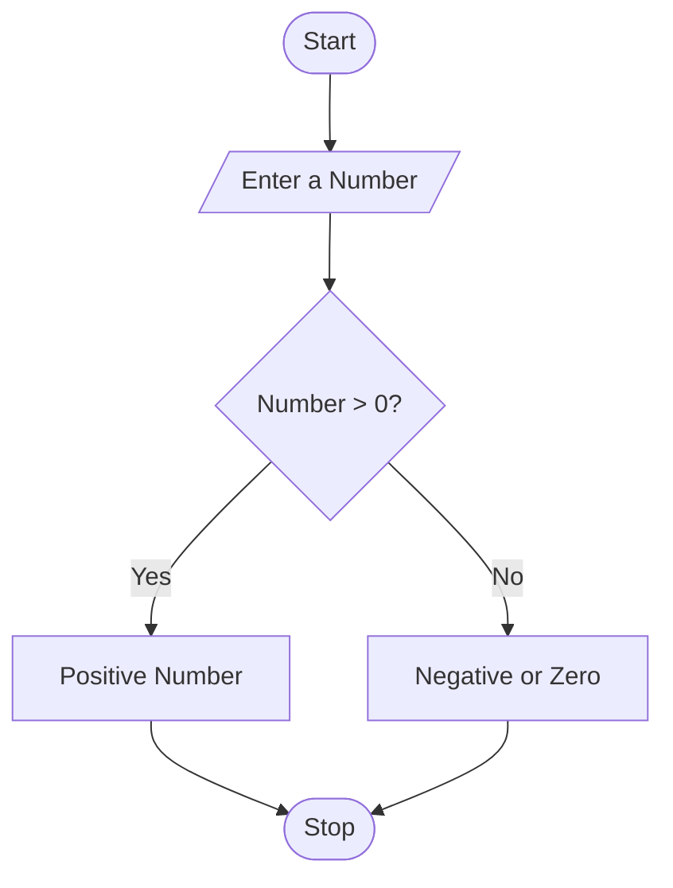

# Traffic Violation Penalty Calculator

## 1. Problem Statement

Develop a Python program to calculate traffic violation penalties for multiple vehicles. The program should accept the vehicle category, offence type, and repeat-offence status for each violation. It should calculate fines based on predefined penalty rules, apply additional fines for repeat offences, calculate the total penalty amount, and identify whether the driver meets any predefined disqualification conditions.

Predefined Fine Rules (Illustrative):

| Offence type       | Fine amount |
| ------------------ | ----------- |
| Over Speeding      | ₹1,000      |
| No Helmet          | ₹500        |
| Signal Jumping     | ₹1,000      |
| No Driving Licence | ₹5,000      |
| Drunk Driving      | ₹10,000     |

Additional rules:

- Repeat offences receive an additional 50% fine.
- Drunk driving results in disqualification.
- Three or more violations result in a disqualification warning.
- Vehicle categories: Two-Wheeler, Four-Wheeler, Heavy Vehicle.

Note: These are hypothetical rules for a programming exercise, not actual legal penalty rates.

## 2. Algorithm

1. Start the program.
2. Define the fine amounts for different offences.
3. Define the available vehicle categories.
4. Read the number of violations.
5. Initialize the total penalty to zero.
6. Repeat the following steps for each violation:
   - Read vehicle category.
   - Read offence type.
   - Read repeat-offence status.
   - Check whether the offence is valid.
   - Calculate the basic fine.
   - If it is a repeat offence, add 50% of the basic fine.
   - Add the fine to the total penalty.
   - Check disqualification conditions.
7. Display the total penalty.
8. Display the disqualification status.
9. Stop the program.

## 3. Flowchart

## 4. Python Source Code

```
    violation_count += 1    fine = fine_rules[offence]    if repeat == "yes":        fine = fine + (fine * 0.50)    total_fine += fine    print("Penalty for this violation: Rs.", fine)    if offence == "drunk driving":        disqualified = True# Check final disqualification conditionsif violation_count >= 3:    disqualified = Trueprint("\n------ FINAL PENALTY REPORT ------")print("Total valid violations:", violation_count)print("Total penalty: Rs.", total_fine)if disqualified:    print("Disqualification Status: YES")    print("Warning: Driver meets disqualification conditions.")else:    print("Disqualification Status: NO")    print("Driver does not meet disqualification conditions.")
```

## 5. Sample Input

```
Enter number of violations: 3

Violation 1
Enter vehicle category: two-wheeler
Enter offence type: no helmet
Is it a repeat offence? (yes/no): no

Violation 2
Enter vehicle category: four-wheeler
Enter offence type: over speeding
Is it a repeat offence? (yes/no): yes

Violation 3
Enter vehicle category: heavy vehicle
Enter offence type: drunk driving
Is it a repeat offence? (yes/no): no
```

## 6. Sample Output

```
Violation 1
Penalty for this violation: Rs. 500

Violation 2
Penalty for this violation: Rs. 1500.0

Violation 3
Penalty for this violation: Rs. 10000

------ FINAL PENALTY REPORT ------
Total valid violations: 3
Total penalty: Rs. 12000.0
Disqualification Status: YES
Warning: Driver meets disqualification conditions.
```

## 7. Result

The Python program successfully calculates traffic violation penalties for multiple offences, applies additional fines for repeat offences, calculates the total penalty, and identifies disqualification conditions using conditional statements, loops, and dictionaries.
