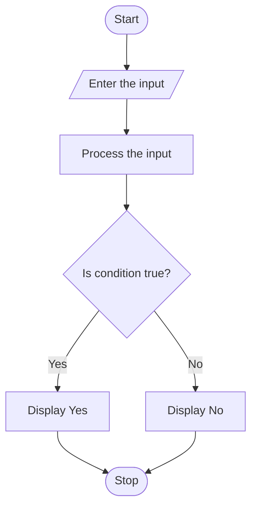

# Campus Transport Allocation

## 1. Problem Statement

Develop a Python program to manage campus transportation for multiple routes. The program should accept the number of passengers on each route and the seating capacity of each bus. It must calculate the minimum number of buses required for each route, determine the total number of buses needed, identify unserved passengers if bus availability is limited, and display a route-wise transport summary.

## 2. Algorithm

1. Start the program.
2. Read the number of routes.
3. Read the passenger demand for each route.
4. Read the seating capacity of each bus.
5. Read the total number of available buses.
6. Calculate the required buses for each route using ceiling division.
7. Allocate available buses to each route.
8. Calculate the number of passengers served.
9. Identify unserved passengers.
10. Display route-wise details and total buses required.
11. Stop the program.

## 3. Flowchart

## 4. Python Source Code

```
# Campus Transport Allocationroutes = int(input("Enter number of routes: "))total_required = 0total_allocated = 0total_unserved = 0demands = []capacities = []for i in range(routes):    print("\nRoute", i + 1)    passengers = int(input("Enter passenger demand: "))    capacity = int(input("Enter bus capacity: "))    if passengers < 0 or capacity <= 0:        print("Invalid input")        exit()    demands.append(passengers)    capacities.append(capacity)available_buses = int(input("\nEnter total available buses: "))if available_buses < 0:    print("Invalid number of buses")    exit()print("\n----- TRANSPORT ALLOCATION -----")remaining_buses = available_busesfor i in range(routes):    passengers = demands[i]    capacity = capacities[i]    required = (passengers + capacity - 1) // capacity    allocated = min(required, remaining_buses)    served = min(passengers, allocated * capacity)    unserved = passengers - served    remaining_buses -= allocated    total_required += required    total_allocated += allocated    total_unserved += unserved    print("\nRoute:", i + 1)    print("Passenger Demand:", passengers)    print("Bus Capacity:", capacity)    print("Buses Required:", required)    print("Buses Allocated:", allocated)    print("Passengers Served:", served)    print("Unserved Passengers:", unserved)print("\n----- FINAL SUMMARY -----")print("Total Buses Required:", total_required)print("Total Buses Allocated:", total_allocated)print("Remaining Buses:", remaining_buses)print("Total Unserved Passengers:", total_unserved)
```

## 5. Sample Input

```
Enter number of routes: 3

Route 1
Enter passenger demand: 100
Enter bus capacity: 50

Route 2
Enter passenger demand: 120
Enter bus capacity: 40

Route 3
Enter passenger demand: 90
Enter bus capacity: 45

Enter total available buses: 6
```

## 6. Sample Output

```
----- TRANSPORT ALLOCATION -----

Route: 1
Passenger Demand: 100
Bus Capacity: 50
Buses Required: 2
Buses Allocated: 2
Passengers Served: 100
Unserved Passengers: 0

Route: 2
Passenger Demand: 120
Bus Capacity: 40
Buses Required: 3
Buses Allocated: 3
Passengers Served: 120
Unserved Passengers: 0

Route: 3
Passenger Demand: 90
Bus Capacity: 45
Buses Required: 2
Buses Allocated: 1
Passengers Served: 45
Unserved Passengers: 45

----- FINAL SUMMARY -----
Total Buses Required: 7
Total Buses Allocated: 6
Remaining Buses: 0
Total Unserved Passengers: 45
```

## 7. Result

The program successfully calculates the buses required for each campus route, allocates the available buses, calculates passengers served, and identifies unserved passengers.
