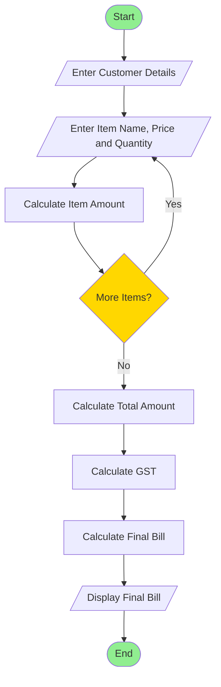

# Retail Billing with Multiple Discount Rules

## 1. Problem Statement

Develop a Python program to generate a retail bill for multiple products purchased by a customer. The program should accept the product name, category, price, and quantity for each item. It should calculate the total price of each product, apply category-specific taxes, and provide discounts based on predefined purchase amount thresholds. The program must also ensure that the total discount does not exceed the maximum concession limit. Finally, it should generate an itemized invoice displaying product details, taxes, discounts, and the final payable amount.

## 2. Algorithm

1. Start the program.
2. Read the number of products.
3. For each product, read:
   - Product name
   - Category
   - Unit price
   - Quantity
4. Calculate the subtotal for each product.
5. Apply category-specific tax rates:
   - Electronics – 18%
   - Clothing – 5%
   - Groceries – 2%
6. Calculate the total amount before discount.
7. Apply threshold discount rules:
   - Below ₹1,000 – No discount.
   - ₹1,000 to ₹4,999 – 5% discount.
   - ₹5,000 to ₹9,999 – 10% discount.
   - ₹10,000 and above – 15% discount.
8. Apply the maximum concession limit of ₹1,500.
9. Calculate the final payable amount.
10. Display the itemized invoice.
11. Stop the program.

## 3. Flowchart





## 4. Python Source Code

```
# Retail Billing with Multiple Discount Rulesn = int(input("Enter number of products: "))subtotal = 0total_tax = 0print("\nEnter Product Details")for i in range(n):    print("\nProduct", i + 1)    name = input("Enter product name: ")    category = input("Enter category: ").lower()    price = float(input("Enter unit price: "))    quantity = int(input("Enter quantity: "))    amount = price * quantity    # Category-specific tax    if category == "electronics":        tax_rate = 18    elif category == "clothing":        tax_rate = 5    elif category == "groceries":        tax_rate = 2    else:        tax_rate = 0    tax = amount * tax_rate / 100    subtotal += amount    total_tax += tax    print("\nProduct:", name)
```

## 5. Sample Input

```
Enter number of products: 3

Product 1
Enter product name: Laptop
Enter category: electronics
Enter unit price: 40000
Enter quantity: 1

Product 2
Enter product name: Shirt
Enter category: clothing
Enter unit price: 1000
Enter quantity: 2

Product 3
Enter product name: Rice
Enter category: groceries
Enter unit price: 500
Enter quantity: 2
```

## 6. Sample Output

```
Product: Laptop
Amount: Rs. 40000.0
Tax: 18 %
Tax Amount: Rs. 7200.0

Product: Shirt
Amount: Rs. 2000.0
Tax: 5 %
Tax Amount: Rs. 100.0

Product: Rice
Amount: Rs. 1000.0
Tax: 2 %
Tax Amount: Rs. 20.0

========== RETAIL INVOICE ==========
Subtotal          : Rs. 43000.0
Total Tax         : Rs. 7320.0
Total Before Discount: 50320.0
Discount Rate     : 15 %
Discount Amount   : Rs. 1500
------------------------------------
Final Payable     : Rs. 48820.0
====================================
```

## 7. Result

Thus, the Python program successfully calculates the retail bill for multiple products by applying category-specific taxes, threshold-based discounts, and maximum concession limits. It generates an itemized invoice showing the final payable amount.
