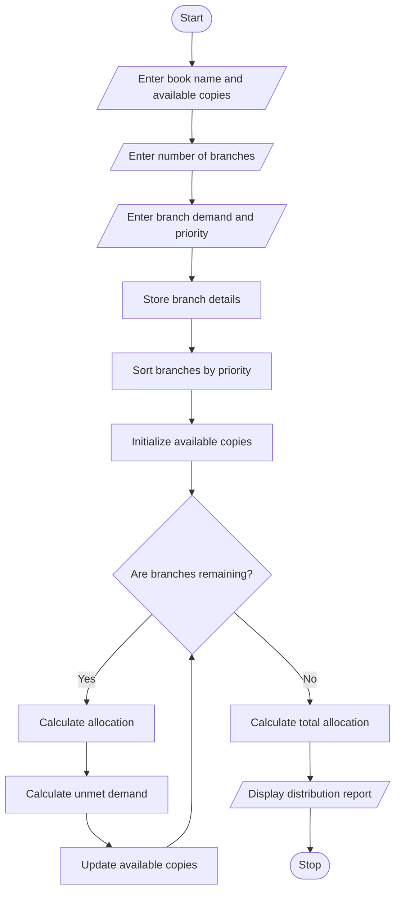

# Multi-Criteria Library Resource Distribution

## 1. Problem Statement

Develop a Python program for Multi-Criteria Library Resource Distribution to analyse the availability of books, borrowing demand, and branch-wise requirements.

The program should:

- Accept the total number of available copies of each book.
- Accept the borrowing demand from multiple library branches.
- Assign priority levels to branches based on their requirements.
- Allocate available books according to priority rules.
- Calculate the number of books allocated to each branch.
- Identify unmet demand when available copies are insufficient.
- Generate a final branch-wise book distribution report.

## 2. Algorithm

1. Start the program.
2. Read the number of books and library branches.
3. Enter the book name and total available copies.
4. Enter the borrowing demand of each branch.
5. Enter the priority level of each branch.
6. Store the branch details in a list.
7. Sort branches according to priority (highest priority first).
8. Allocate available book copies to each branch based on its demand.
9. Calculate unmet demand for every branch.
10. Calculate the total allocated copies and remaining copies.
11. Display the branch-wise allocation report.
12. Stop the program.

## 3. Flowchart


## 4. Python Source Code

```
# Multi-Criteria Library Resource Distributionbook_name = input("Enter book name: ")total_copies = int(input("Enter total available copies: "))n = int(input("Enter number of library branches: "))branches = []for i in range(n):    print("\nEnter details for Branch", i + 1)    name = input("Enter branch name: ")    demand = int(input("Enter book demand: "))    priority = int(input("Enter priority (1-3): "))    branches.append((name, demand, priority))# Sort branches by priority# Priority 1 is highest prioritybranches.sort(key=lambda x: x[2])available = total_copiestotal_allocated = 0total_unmet = 0print("\n========== LIBRARY DISTRIBUTION REPORT ==========")print("Book Name:", book_name)print("Total Available Copies:", total_copies)print("\nBranch\t\tDemand\tPriority\tAllocated\tUnmet")for name, demand, priority in branches:    allocated = min(demand, available)
```

## 5. Sample Input

```
Enter book name: Python Programming
Enter total available copies: 50
Enter number of library branches: 4

Enter details for Branch 1
Enter branch name: Main
Enter book demand: 25
Enter priority (1-3): 1

Enter details for Branch 2
Enter branch name: Science
Enter book demand: 20
Enter priority (1-3): 2

Enter details for Branch 3
Enter branch name: Computer
Enter book demand: 15
Enter priority (1-3): 1

Enter details for Branch 4
Enter branch name: Arts
Enter book demand: 10
Enter priority (1-3): 3
```

## 6. Sample Output

```
========== LIBRARY DISTRIBUTION REPORT ==========

Book Name: Python Programming
Total Available Copies: 50

Branch      Demand  Priority  Allocated  Unmet
Main          25       1         25        0
Computer      15       1         15        0
Science       20       2         10       10
Arts          10       3          0       10

Total Allocated Copies: 50
Total Unmet Demand: 20
Remaining Copies: 0

Distribution Completed.
```

## 7. Concepts Used in Python

| Concept              | Purpose                       |
| -------------------- | ----------------------------- |
| Variables            | Store book and branch details |
| Lists                | Store branch information      |
| Tuples               | Store demand and priority     |
| For loop             | Read branch details           |
| If conditions        | Check allocation conditions   |
| `sort()`             | Arrange branches by priority  |
| `min()`              | Allocate available copies     |
| Arithmetic operators | Calculate unmet demand        |

Conclusion: This program distributes available library books among different branches according to their priority levels. It calculates allocated copies, remaining stock, and unmet demand, helping libraries manage resources efficiently.
