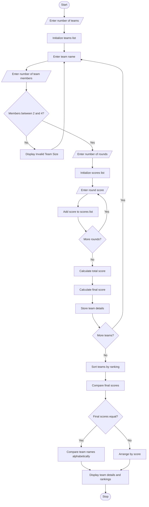

# Hackathon Team Formation and Ranking – Python Program

## 1. Problem Statement

The Hackathon Team Formation and Ranking system is designed to analyse student scores and team compositions. It validates whether each team has the required number of members, calculates the total score of each team across multiple rounds, and ranks teams based on their performance. If two or more teams receive the same total score, the system resolves the tie using predefined rules, such as the highest score in the final round. Finally, it displays the team details, total scores, and final rankings.

## 2. Algorithm

1. Start the program.
2. Enter the minimum and maximum number of students allowed per team.
3. Enter the number of teams participating in the hackathon.
4. For each team:
   - Enter the team name.
   - Enter the number of team members.
   - Validate the team size.
   - Enter the number of rounds.
   - Enter each round's score.
5. Calculate the total score of each valid team.
6. Compare team scores.
7. If total scores are equal, compare the final-round scores.
8. If final-round scores are also equal, compare team names alphabetically.
9. Sort all valid teams according to their rankings.
10. Display team details, total scores, and rankings.
11. Stop the program.

## 3. Python Source Code



## 4. Sample Input

```
Enter number of teams: 4

Enter details for Team 1
Enter team name: Alpha
Enter number of team members: 3
Enter number of rounds: 3
Enter Round 1 score: 80
Enter Round 2 score: 90
Enter Round 3 score: 85

Enter details for Team 2
Enter team name: Beta
Enter number of team members: 2
Enter number of rounds: 3
Enter Round 1 score: 85
Enter Round 2 score: 85
Enter Round 3 score: 85

Enter details for Team 3
Enter team name: Gamma
Enter number of team members: 5

Enter details for Team 4
Enter team name: Delta
Enter number of team members: 4
Enter number of rounds: 3
Enter Round 1 score: 90
Enter Round 2 score: 90
Enter Round 3 score: 90
```

## 5. Sample Output

```
Invalid team size! Team must have 2 to 4 members.

========== HACKATHON RESULTS ==========

Rank: 1
Team Name: Delta
Team Members: 4
Round Scores: [90, 90, 90]
Total Score: 270
Final Round Score: 90

Rank: 2
Team Name: Beta
Team Members: 2
Round Scores: [85, 85, 85]
Total Score: 255
Final Round Score: 85

Rank: 3
Team Name: Alpha
Team Members: 3
Round Scores: [80, 90, 85]
Total Score: 255
Final Round Score: 85

========== END OF RESULTS ==========
```

## 6. Concepts Used

| Concept         | Purpose                 |
| --------------- | ----------------------- |
| Lists           | Store round-wise scores |
| Dictionaries    | Store team details      |
| For loop        | Process multiple teams  |
| If-else         | Validate team sizes     |
| `sum()`         | Calculate total scores  |
| `sort()`        | Rank teams              |
| Lambda function | Resolve tied rankings   |

Tie-breaking rules:

1. Highest total score gets first preference.
2. If total scores are equal, highest final-round score gets preference.
3. If both scores are equal, alphabetical team name decides the order.

Note: Invalid teams are excluded from the ranking. The program uses 2–4 members as the permitted team size.
