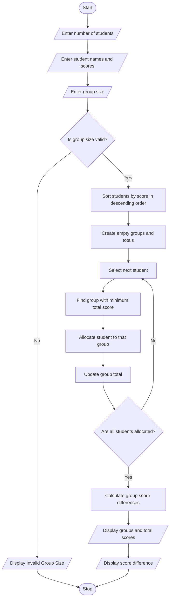

# Student Group Formation with Score Balancing – Python Program

## 1. Problem Statement

The Student Group Formation with Score Balancing system is used to divide students into groups based on their scores. The program accepts student names and their scores, validates the group size, and allocates students into groups so that the total scores of each group are as balanced as possible. It uses sorting and score comparison to minimize the difference between group totals. Finally, it displays the students in each group, their individual scores, group totals, and the difference between the highest and lowest group scores.

## 2. Algorithm

1. Start the program.
2. Enter the number of students.
3. Enter each student's name and score.
4. Enter the required group size.
5. Validate the group size.
6. Sort students according to their scores in descending order.
7. Create the required number of empty groups.
8. Calculate the total score of each group.
9. Allocate each student to the group having the lowest total score.
10. Repeat until all students are allocated.
11. Display the students and total score of each group.
12. Calculate the difference between the highest and lowest group totals.
13. Stop the program.

## 3. Python Source Code

```
    num_groups = (len(students) + group_size - 1) // group_size    # Sort students by highest score    students.sort(key=lambda x: x[1], reverse=True)    # Create empty groups    groups = [[] for i in range(num_groups)]    totals = [0] * num_groups    # Allocate students to the group with    # the lowest total and available space    for student in students:        available = [            i for i in range(num_groups)            if len(groups[i]) < group_size        ]        best_group = min(            available,            key=lambda i: totals[i]        )        groups[best_group].append(student)        totals[best_group] += student[1]    # Display results    print("\n===== STUDENT GROUP RESULTS =====")    for i in range(num_groups):        print("\nGroup", i + 1)        for name, score in groups[i]:            print(name, "-", score)        print("Group Total:", totals[i])    # Calculate score difference    difference = max(totals) - min(totals)    print("\nHighest Group Total:", max(totals))    print("Lowest Group Total:", min(totals))    print("Score Difference:", difference)    print("\n===== GROUP FORMATION COMPLETED =====")
```

## 4. Sample Input

```
Enter number of students: 8

Enter student name: Ravi
Enter student score: 90

Enter student name: Priya
Enter student score: 85

Enter student name: Arun
Enter student score: 80

Enter student name: Sita
Enter student score: 75

Enter student name: Kiran
Enter student score: 70

Enter student name: Divya
Enter student score: 65

Enter student name: Rahul
Enter student score: 60

Enter student name: Sneha
Enter student score: 55

Enter group size: 2
```

## 5. Sample Output

```
===== STUDENT GROUP RESULTS =====

Group 1
Ravi - 90
Sneha - 55
Group Total: 145

Group 2
Priya - 85
Rahul - 60
Group Total: 145

Group 3
Arun - 80
Divya - 65
Group Total: 145

Group 4
Sita - 75
Kiran - 70
Group Total: 145

Highest Group Total: 145
Lowest Group Total: 145
Score Difference: 0

===== GROUP FORMATION COMPLETED =====
```

## 6. Concepts Used

| Python concept | Purpose                               |
| -------------- | ------------------------------------- |
| Lists          | Store student details                 |
| Tuples         | Store student name and score          |
| Nested lists   | Store multiple groups                 |
| For loop       | Process students                      |
| If condition   | Validate group size                   |
| `sort()`       | Arrange scores                        |
| `min()`        | Find the group with the lowest total  |
| `max()`        | Find the highest group total          |
| `sum()`        | Calculate totals (alternative method) |

Expected Result: Students are divided into groups with balanced total scores. The objective is to minimize the difference between the highest and lowest group totals.
## 7. flowchart (mermaid TD)

