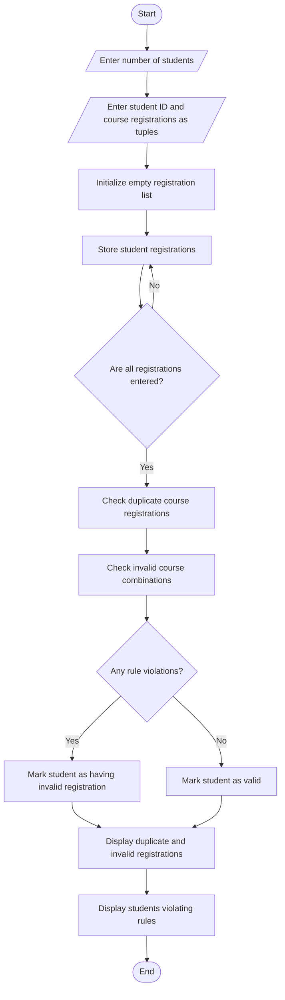

# Tuple-Based Course Registration Validation – Python Program

## 1. Problem Statement

The Tuple-Based Course Registration Validation system is designed to validate student course registrations using Python tuples. The program stores student IDs and selected course names as tuples. It identifies duplicate course registrations, checks invalid course combinations according to predefined rules, and determines which students have violated registration rules. Finally, it displays valid registrations, duplicate entries, invalid combinations, and the list of students whose registrations need correction.

## 2. Algorithm

1. Start the program.
2. Enter the number of students.
3. Enter each student's ID and registered courses.
4. Store student details using tuples.
5. Define the available courses.
6. Define invalid course combinations.
7. Check each student's registration.
8. Identify duplicate courses.
9. Check whether the selected courses are valid.
10. Identify students who selected invalid course combinations.
11. Display valid and invalid registrations.
12. Display students who violated registration rules.
13. Stop the program.

## 3. Python Source Code

```
# Tuple-Based Course Registration Validationregistrations = []# Available coursesavailable_courses = (    "Python", "Java", "C", "DBMS",    "AI", "Web")# Invalid course combinationsinvalid_combinations = [    ("Python", "Java"),    ("C", "Java")]n = int(input("Enter number of students: "))# Collect student registrationsfor i in range(n):    print("\nStudent", i + 1)    student_id = input("Enter student ID: ")    courses = input(        "Enter courses separated by spaces: "    ).split()    # Store registration as tuple    registration = (student_id, tuple(courses))    registrations.append(registration)# Validation processviolated_students = []
```

## 4. Sample Input

```
Enter number of students: 4

Student 1
Enter student ID: S101
Enter courses separated by spaces: Python DBMS AI

Student 2
Enter student ID: S102
Enter courses separated by spaces: Python Python Web

Student 3
Enter student ID: S103
Enter courses separated by spaces: Python Java AI

Student 4
Enter student ID: S104
Enter courses separated by spaces: C DBMS Web
```

## 5. Sample Output

```
===== COURSE REGISTRATION REPORT =====

Student ID: S101
Registered Courses: ('Python', 'DBMS', 'AI')
Status: Registration Valid

Student ID: S102
Registered Courses: ('Python', 'Python', 'Web')
Duplicate Courses: ['Python']
Status: Registration Invalid

Student ID: S103
Registered Courses: ('Python', 'Java', 'AI')
Invalid Combinations: [('Python', 'Java')]
Status: Registration Invalid

Student ID: S104
Registered Courses: ('C', 'DBMS', 'Web')
Status: Registration Valid

===== FINAL SUMMARY =====

Total Students: 4
Students with Violations: 2
Violation Student IDs: ['S102', 'S103']

===== VALIDATION COMPLETED =====
```

## 6. Concepts Used

| Python concept             | Purpose                            |
| -------------------------- | ---------------------------------- |
| Tuples                     | Store student registration details |
| Lists                      | Store multiple registrations       |
| Nested tuples              | Store registered courses           |
| For loop                   | Process student records            |
| If condition               | Validate registrations             |
| `count()`                  | Identify duplicate courses         |
| `append()`                 | Store violation details            |
| Membership operator (`in`) | Check course availability          |
| Tuple comparison           | Check invalid combinations         |
## 7. flowchart (Mermaid TD)


