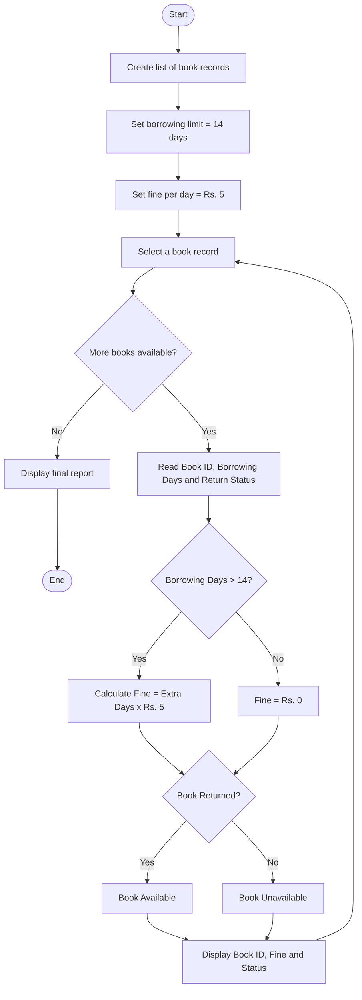

# Library Borrowing and Fine Reconciliation – Python Program

## 1. Problem Statement

The Library Borrowing and Fine Reconciliation system analyses book borrowing and returning records using tuples. It stores book IDs, borrowing periods, and return delays. The program calculates fines for overdue books, identifies overdue records, checks book availability, and generates a final library report.

Rules:

- Each book has a unique Book ID.
- Borrowing period is 14 days.
- Fine is ₹5 per overdue day.
- Books returned within 14 days have no fine.
- A book is available after it is returned.
- A book not yet returned is considered unavailable.

## 2. Algorithm

1. Start the program.
2. Create a list of tuples containing Book ID, borrowing days, and return status.
3. Set the borrowing limit to 14 days.
4. Set the fine per overdue day to ₹5.
5. Read each book record.
6. Calculate overdue days by subtracting 14 from borrowing days.
7. If overdue days are greater than zero, calculate the fine.
8. Identify overdue books.
9. Check whether each book is available or unavailable.
10. Calculate the total fine.
11. Display the borrowing report.
12. Stop the program.

## 3. Flowchart (mermaid TD)

## 4. Python Source Code

```
# Library Borrowing and Fine Reconciliation# Tuple format:# (Book ID, Borrowing Days, Return Status)books = [    ("B101", 18, True),    ("B102", 10, True),    ("B103", 20, False),    ("B104", 14, True),    ("B105", 17, True)]BORROWING_LIMIT = 14FINE_PER_DAY = 5total_fine = 0overdue_count = 0available_count = 0unavailable_count = 0print("========== LIBRARY REPORT ==========")print("Book ID  Days  Overdue  Fine  Status")print("------------------------------------")for book in books:    book_id, days, returned = book    if returned:        overdue_days = max(0, days - BORROWING_LIMIT)        fine = overdue_days * FINE_PER_DAY        status = "Available"        available_count += 1
```

## 5. Sample Input

The following records are given in the program:

```
B101  18  True
B102  10  True
B103  20  False
B104  14  True
B105  17  True
```

## 6. Sample Output

```
========== LIBRARY REPORT ==========
Book ID  Days  Overdue  Fine  Status
------------------------------------
B101     18    4        20    Available
B102     10    0        0     Available
B103     20    6        0     Unavailable
B104     14    0        0     Available
B105     17    3        15    Available
------------------------------------
Total Overdue Books: 2
Available Books: 4
Unavailable Books: 1
Total Fine: Rs. 35
====================================
```

## 7. Result

The Library Borrowing and Fine Reconciliation program successfully analyses book records using tuples, calculates overdue fines, identifies overdue books, checks book availability, and displays the total fine amount.

Concepts used: Tuples, Lists, Loops, Conditional Statements, Arithmetic Operations, and Variables.
