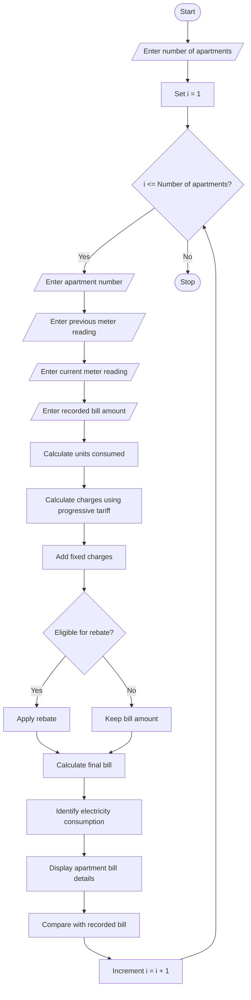

# Smart Electricity Billing for Multiple Apartments

## 1. Problem Statement

Develop a Python program to calculate electricity bills for multiple apartments in an apartment complex. The program should calculate electricity charges based on units consumed using progressive tariff rates, add fixed charges, apply eligible rebates, identify billing discrepancies, and rank apartments according to their electricity consumption.

## 2. Algorithm

1. Start the program.
2. Read the number of apartments.
3. For each apartment, read:
   - Apartment number
   - Previous meter reading
   - Current meter reading
   - Recorded bill amount
4. Calculate electricity consumption:

`Units = Current Reading - Previous Reading`

5. Calculate electricity charges using progressive tariff rates:
   - First 100 units: ₹2 per unit
   - Next 100 units: ₹3 per unit
   - Above 200 units: ₹5 per unit
6. Add fixed charges of ₹50.
7. Apply a 10% rebate if consumption is below 100 units.
8. Calculate the final bill.
9. Compare the calculated bill with the recorded bill.
10. Identify billing discrepancies.
11. Rank apartments according to electricity consumption.
12. Display apartment-wise billing details and ranking.
13. Stop.

## 3. Flowchart


## 4. Python Source Code

```
# Smart Electricity Billing for Multiple Apartmentsn = int(input("Enter number of apartments: "))apartments = []for i in range(n):    print("\nApartment", i + 1)    apt_no = input("Enter apartment number: ")    previous = int(input("Enter previous meter reading: "))    current = int(input("Enter current meter reading: "))    recorded_bill = float(input("Enter recorded bill amount: "))    # Validate meter readings    if current < previous:        print("Invalid meter readings!")        continue    units = current - previous    # Progressive tariff calculation    if units <= 100:        energy_charge = units * 2    elif units <= 200:        energy_charge = (100 * 2) + (units - 100) * 3    else:        energy_charge = (100 * 2) + (100 * 3) + (units - 200) * 5    # Fixed charge    fixed_charge = 50    subtotal = energy_charge + fixed_charge
```

## 5. Sample Input

```
Enter number of apartments: 3

Apartment 1
Enter apartment number: A101
Enter previous meter reading: 1000
Enter current meter reading: 1080
Enter recorded bill amount: 194

Apartment 2
Enter apartment number: A102
Enter previous meter reading: 2000
Enter current meter reading: 2150
Enter recorded bill amount: 500

Apartment 3
Enter apartment number: A103
Enter previous meter reading: 3000
Enter current meter reading: 3250
Enter recorded bill amount: 1000
```

## 6. Sample Output

```
------ ELECTRICITY BILL DETAILS ------

Apartment: A101
Units Consumed: 80
Energy Charge: Rs. 160
Fixed Charge: Rs. 50
Rebate: Rs. 21
Final Bill: Rs. 189
Recorded Bill: Rs. 194
Status: Discrepancy Found

Apartment: A102
Units Consumed: 150
Energy Charge: Rs. 350
Fixed Charge: Rs. 50
Rebate: Rs. 0
Final Bill: Rs. 400
Recorded Bill: Rs. 500
Status: Discrepancy Found

Apartment: A103
Units Consumed: 250
Energy Charge: Rs. 750
Fixed Charge: Rs. 50
Rebate: Rs. 0
Final Bill: Rs. 800
Recorded Bill: Rs. 1000
Status: Discrepancy Found

------ CONSUMPTION RANKING ------

1. A103 - 250 units
2. A102 - 150 units
3. A101 - 80 units

------ BILLING DISCREPANCIES ------

Apartment: A101 | Difference: Rs. 5
Apartment: A102 | Difference: Rs. 100
Apartment: A103 | Difference: Rs. 200

Total Apartments Processed: 3
```

## 7. Concepts Used in Python

1. Variables – Store apartment and billing details.
2. Conditional Statements – Apply progressive tariff rates.
3. Loops – Process multiple apartments.
4. Lists – Store apartment information.
5. Dictionaries – Maintain individual billing records.
6. Functions – Use built-in `sorted()` and `round()`.
7. Sorting – Rank apartments based on electricity consumption.

Conclusion: This program calculates electricity bills for multiple apartments, applies rebates and fixed charges, detects billing discrepancies, and ranks apartments based on their electricity consumption.
